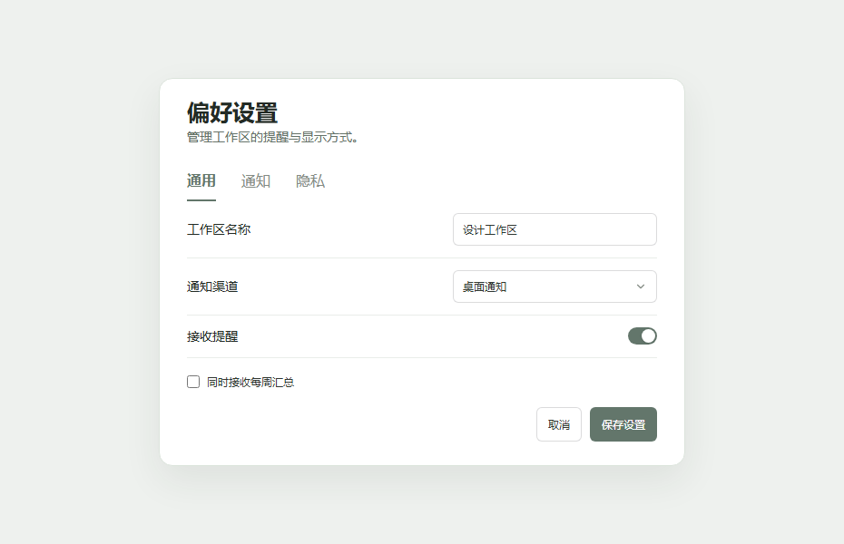

# Loom UI

**一套可独立使用的 React 基础组件。**

按钮、表单、菜单、弹窗和布局共用一套主题 Token。组件支持受控状态、键盘操作和深浅主题。



## 从源码安装

需要 Node.js 22.18+ 和 pnpm 11。

```sh
git clone https://github.com/Moduloom/loom-ui.git
cd loom-ui
pnpm install --frozen-lockfile
pnpm build
pnpm pack --pack-destination dist
```

在你的 React 项目中，用 `pnpm add` 安装生成的 `loom-ui/dist/loom-ui-0.1.0.tgz`。相邻目录的安装示例如下。

```sh
pnpm add ../loom-ui/dist/loom-ui-0.1.0.tgz
```

```tsx
import { Button } from 'loom-ui';
import 'loom-ui/styles.css';

export function SaveButton({ onSave }: { onSave: () => void }) {
  return <Button variant="primary" onClick={onSave}>保存</Button>;
}
```

更多组件见 [导出列表](src/index.ts)。交互预览框架见 [Moduloom](https://github.com/Moduloom/moduloom)。

## 许可证

[GPL v3](LICENSE)
